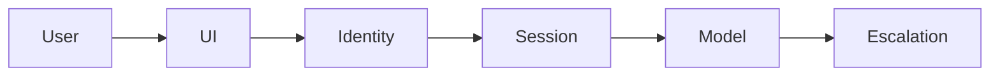

# Conversational AI

## Logical architecture

## Data flow and trust boundary

Keep session history scoped to the verified user and expire it. Bound context; never use prior model text as policy authority.

## Trade-offs and validation

Measure escalation accuracy and session leakage. A simple stateless assistant may be sufficient.

## Customer design decisions

Record data classification, scale, p95 latency target, acceptable failure behavior, operating owner and deployment boundary in the [solution one-pager](../templates/solution-design-one-pager.md). Trace a normal request and a rejected request across every component.

## Implementation scope

This is a reference design, not a claim that every box is implemented in the educational labs. Compare it with [the security playbook](../docs/05-ai-security-playbook.md) before proposing a production deployment.
