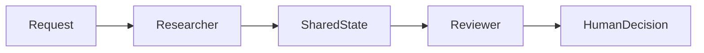

# Multi-agent review

## Logical architecture

## Data flow and trust boundary

Separate roles and explicit state, not authority. Prevent unbounded recursion, control handoff size and avoid privileged credentials in shared memory.

## Trade-offs and validation

Measure improvement versus one agent. Multiple agents using the same model can share errors.

## Customer design decisions

Record data classification, scale, p95 latency target, acceptable failure behavior, operating owner and deployment boundary in the [solution one-pager](../templates/solution-design-one-pager.md). Trace a normal request and a rejected request across every component.

## Implementation scope

This is a reference design, not a claim that every box is implemented in the educational labs. Compare it with [the security playbook](../docs/05-ai-security-playbook.md) before proposing a production deployment.
