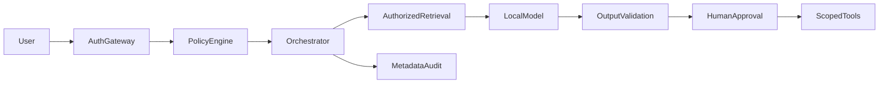

# Secure enterprise AI

## Logical architecture

## Data flow and trust boundary

Trust identity and authorization services, not model text. Separate ingestion, retrieval, generation and action planes. Supply-chain review, encryption and retention span all layers.

## Trade-offs and validation

The code demonstrates pre-retrieval tenant filtering and tool validation only. Gateway identity, persistent approvals and enterprise controls are implementation requirements, not claimed features.

## Customer design decisions

Record data classification, scale, p95 latency target, acceptable failure behavior, operating owner and deployment boundary in the [solution one-pager](../templates/solution-design-one-pager.md). Trace a normal request and a rejected request across every component.

## Implementation scope

This is a reference design, not a claim that every box is implemented in the educational labs. Compare it with [the security playbook](../docs/05-ai-security-playbook.md) before proposing a production deployment.
