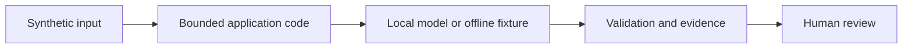

# Lab 04: Ground answers in policy

## Scenario and prerequisites

You advise fictional Northstar Services using synthetic policy and procurement data. Complete [setup](../../docs/02-environment-setup.md). Allow 90–150 minutes. Complete [lab 3](../lab-03-customer-support-chatbot/README.md) first.

## Run from the repository root

```bash
python scripts/run_lab.py --lab 4 --offline
python scripts/run_lab.py --lab 4
python scripts/run_lab.py --lab 4 --chroma
```

The live command needs Ollama and the downloaded models. The optional Chroma/LangGraph flags need packages in `requirements.txt`; they also work with `--offline`. Change the user question with `--question "your synthetic question"` where relevant. See [shared implementation](../../src/advisor/core.py) and [runner](../../scripts/run_lab.py).

## Exercise

1. Run the built-in cosine retriever, then rerun with --chroma. Inspect source IDs against data/policies.json. Add a synthetic policy paragraph and compare retrieval.
2. Ask about an absent travel policy. Record whether the model abstains; failure is a finding, not a reason to hide the case.
3. Explain why retrieval recall and answer faithfulness require different tests.
4. Save your observations in an ignored `artifacts/lab-04-notes.md`, including versions, input, expected behavior, actual behavior and residual risk.

## Expected result and acceptance criteria

The result lists only Northstar sources. Live generation should cite supplied IDs; verify each factual claim manually.

- [ ] The command exits successfully for the supported synthetic case.
- [ ] Inspect `artifacts/lab-04.json`; distinguish model output from deterministic policy decisions.
- [ ] Record one negative case and its expected outcome.
- [ ] Explain the customer decision supported by your evidence.
- [ ] Run the live version before claiming model-quality results.

## Architecture



## Security and limitations

No external account, credentials or production data are needed. Generated answers remain untrusted. Offline fixtures bypass model reasoning and are unsuitable for prompt quality or injection-resistance claims. The demo has no production identity provider, multi-user storage, persistent approval system or distributed rate limiter.

## Troubleshooting and cleanup

For connection or missing-model errors, follow [troubleshooting](../../docs/07-troubleshooting-guide.md). A schema or tool-validation error can be an intended rejection: inspect the proposal before changing controls. Outputs overwrite the lab JSON; traces append. Delete only your generated files under `artifacts/` when finished; source fixtures remain reusable.

## Next step

Continue to [lab 5](../lab-05-document-intelligence-workflow/README.md) when directed by the [learning path](../../docs/00-learning-path.md).
