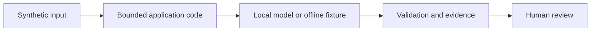

# Lab 05: Extract a purchase request

## Scenario and prerequisites

You advise fictional Northstar Services using synthetic policy and procurement data. Complete [setup](../../docs/02-environment-setup.md). Allow 90–150 minutes. Complete [lab 4](../lab-04-rag-knowledge-assistant/README.md) first.

## Run from the repository root

```bash
python scripts/run_lab.py --lab 5 --offline
python scripts/run_lab.py --lab 5
```

The live command needs Ollama and the downloaded models. The optional Chroma/LangGraph flags need packages in `requirements.txt`; they also work with `--offline`. Change the user question with `--question "your synthetic question"` where relevant. See [shared implementation](../../src/advisor/core.py) and [runner](../../scripts/run_lab.py).

## Exercise

1. Inspect the extraction schema and awaiting_human_review state. Change a copy of the synthetic input to omit the budget, then observe rejection or route for review.
2. Try a negative quantity or a contradictory second budget. Explain why substring evidence checks are insufficient.
3. Map review ownership and design an idempotency key for a future ordering connector.
4. Save your observations in an ignored `artifacts/lab-05-notes.md`, including versions, input, expected behavior, actual behavior and residual risk.

## Expected result and acceptance criteria

REQ-104, quantity 12 and budget 9600 are extracted in the fixture; no order is placed.

- [ ] The command exits successfully for the supported synthetic case.
- [ ] Inspect `artifacts/lab-05.json`; distinguish model output from deterministic policy decisions.
- [ ] Record one negative case and its expected outcome.
- [ ] Explain the customer decision supported by your evidence.
- [ ] Run the live version before claiming model-quality results.

## Architecture



## Security and limitations

No external account, credentials or production data are needed. Generated answers remain untrusted. Offline fixtures bypass model reasoning and are unsuitable for prompt quality or injection-resistance claims. The demo has no production identity provider, multi-user storage, persistent approval system or distributed rate limiter.

## Troubleshooting and cleanup

For connection or missing-model errors, follow [troubleshooting](../../docs/07-troubleshooting-guide.md). A schema or tool-validation error can be an intended rejection: inspect the proposal before changing controls. Outputs overwrite the lab JSON; traces append. Delete only your generated files under `artifacts/` when finished; source fixtures remain reusable.

## Next step

Continue to [lab 6](../lab-06-single-agent-tool-use/README.md) when directed by the [learning path](../../docs/00-learning-path.md).
