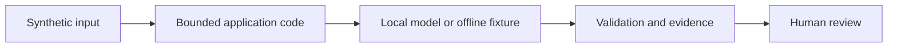

# Lab 10: Inspect observability

## Scenario and prerequisites

You advise fictional Northstar Services using synthetic policy and procurement data. Complete [setup](../../docs/02-environment-setup.md). Allow 90–150 minutes. Complete [lab 9](../lab-09-ai-security-red-team/README.md) first.

## Run from the repository root

```bash
python scripts/run_lab.py --lab 10 --offline
python scripts/run_lab.py --lab 10
python -m streamlit run scripts/dashboard.py --server.address 127.0.0.1
```

The live command needs Ollama and the downloaded models. The optional Chroma/LangGraph flags need packages in `requirements.txt`; they also work with `--offline`. Change the user question with `--question "your synthetic question"` where relevant. See [shared implementation](../../src/advisor/core.py) and [runner](../../scripts/run_lab.py).

## Exercise

1. Run five calls, then open the dashboard. Compare offline and live modes separately. Inspect metadata-only JSONL traces and calculate the effect of historical samples.
2. Stop Ollama to generate an error event. Confirm the trace records the failure without the prompt.
3. Define POC quality and latency gates before selecting a model.
4. Save your observations in an ignored `artifacts/lab-10-notes.md`, including versions, input, expected behavior, actual behavior and residual risk.

## Expected result and acceptance criteria

p50 and p95 generation latency are reported, with mode and sample count. No prompt content or invented dollar cost appears.

- [ ] The command exits successfully for the supported synthetic case.
- [ ] Inspect `artifacts/lab-10.json`; distinguish model output from deterministic policy decisions.
- [ ] Record one negative case and its expected outcome.
- [ ] Explain the customer decision supported by your evidence.
- [ ] Run the live version before claiming model-quality results.

## Architecture



## Security and limitations

No external account, credentials or production data are needed. Generated answers remain untrusted. Offline fixtures bypass model reasoning and are unsuitable for prompt quality or injection-resistance claims. The demo has no production identity provider, multi-user storage, persistent approval system or distributed rate limiter.

## Troubleshooting and cleanup

For connection or missing-model errors, follow [troubleshooting](../../docs/07-troubleshooting-guide.md). A schema or tool-validation error can be an intended rejection: inspect the proposal before changing controls. Outputs overwrite the lab JSON; traces append. Delete only your generated files under `artifacts/` when finished; source fixtures remain reusable.

## Next step

Continue to [lab 11](../lab-11-capstone-secure-ai-advisor/README.md) when directed by the [learning path](../../docs/00-learning-path.md).
