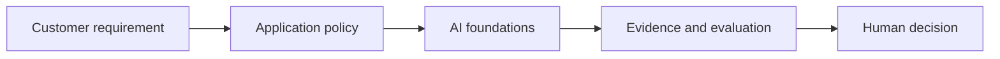

# AI foundations

[Learning path](../../docs/00-learning-path.md) · Module 1 of 13

## Learning objectives

Distinguish predictive ML, deep learning and generative AI; explain why fluent output is not evidence.

## Prerequisites and estimated time

Enterprise cloud, networking and security fundamentals; basic Python syntax. Allow 60–90 minutes for concepts and 90–150 minutes for the lab and consulting artifact.

## Customer scenario

A CIO wants to replace a rules engine with AI.

## Concepts

AI is the broad field; ML learns patterns from data; deep learning uses layered neural networks. Generative models synthesize content. Choose deterministic rules when requirements are exact and stable. Training changes weights; inference uses them.

## Hands-on lab

Complete [lab-01-local-llm-setup](../../labs/lab-01-local-llm-setup/README.md). Record the command, configuration, observed result and one limitation. 

## Architecture diagram

Identify the untrusted input and the authority that approves an action. Expand the relevant [reference architecture](../../architectures/secure-ai-reference-architecture.md) with customer-specific boundaries.

## Troubleshooting

If the lab cannot reach Ollama, check its URL and service before changing prompts. If output is inconsistent, preserve the input and model tag, rerun the same case, and compare against the rubric. Offline fixtures validate plumbing only. See [troubleshooting](../../docs/07-troubleshooting-guide.md).

## Security considerations

Treat all model output and retrieved text as untrusted. Use synthetic data, minimize retained content and enforce permissions outside the model. For this scenario, document one disclosure risk, one integrity risk and one operational failure with an owner.

## Customer conversation prompts

Which decision actually needs generation? What is the cost of a wrong answer?

## Knowledge check

1. When should you retain a rules engine?
2. Name one failure mode in this scenario and a measurable test for it.
3. Explain the design trade-off to a non-specialist in two sentences.

Answer guidance

When outputs must be exact and the rules are known. A strong scenario answer names an observable failure, the control enforcing the boundary and a pass/fail test; trade-offs should connect quality, cost or latency to the customer's requirement.

## Deliverable and next step

- [ ] Complete the lab acceptance criteria.
- [ ] Write a five-sentence customer recommendation with evidence and residual risk.
- [ ] Explain the knowledge-check answers without reading the lesson.

Continue to [LLMs and prompting](../02-llms-and-prompting/README.md).
