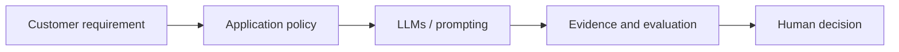

# LLMs and prompting

[Learning path](../../docs/00-learning-path.md) · Module 2 of 13

## Learning objectives

Explain tokens, context, temperature and parameters; compare prompts using a fixed rubric.

## Prerequisites and estimated time

Complete [module 1](../01-ai-foundations/README.md). Allow 60–90 minutes for concepts and 90–150 minutes for the lab and consulting artifact.

## Customer scenario

A sales team needs repeatable account summaries.

## Concepts

Tokens are model-specific text units. Context includes instructions, retrieved data, history and output budget. Parameters are learned weights, not a database. Temperature changes sampling, not truthfulness. Use instructions, evidence, examples, constraints and explicit formats; validate outputs separately.

## Hands-on lab

Complete [lab-02-prompt-engineering](../../labs/lab-02-prompt-engineering/README.md). Record the command, configuration, observed result and one limitation. 

## Architecture diagram

Identify the untrusted input and the authority that approves an action. Expand the relevant [reference architecture](../../architectures/secure-ai-reference-architecture.md) with customer-specific boundaries.

## Troubleshooting

If the lab cannot reach Ollama, check its URL and service before changing prompts. If output is inconsistent, preserve the input and model tag, rerun the same case, and compare against the rubric. Offline fixtures validate plumbing only. See [troubleshooting](../../docs/07-troubleshooting-guide.md).

## Security considerations

Treat all model output and retrieved text as untrusted. Use synthetic data, minimize retained content and enforce permissions outside the model. For this scenario, document one disclosure risk, one integrity risk and one operational failure with an owner.

## Customer conversation prompts

What evidence should a summary cite? Which omissions are unacceptable?

## Knowledge check

1. Does temperature zero guarantee correctness?
2. Name one failure mode in this scenario and a measurable test for it.
3. Explain the design trade-off to a non-specialist in two sentences.

Answer guidance

No; low sampling variability does not establish factual accuracy. A strong scenario answer names an observable failure, the control enforcing the boundary and a pass/fail test; trade-offs should connect quality, cost or latency to the customer's requirement.

## Deliverable and next step

- [ ] Complete the lab acceptance criteria.
- [ ] Write a five-sentence customer recommendation with evidence and residual risk.
- [ ] Explain the knowledge-check answers without reading the lesson.

Continue to [Conversational AI](../03-conversational-ai/README.md).
