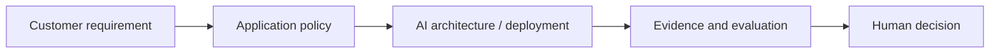

# AI architecture and deployment

[Learning path](../../docs/00-learning-path.md) · Module 8 of 13

## Learning objectives

Compare local, cloud and hybrid deployment; identify trust boundaries.

## Prerequisites and estimated time

Complete [module 7](../07-multi-agent-systems/README.md). Allow 60–90 minutes for concepts and 90–150 minutes for the lab and consulting artifact.

## Customer scenario

A regulated customer needs an internal knowledge assistant.

## Concepts

Separate UI, identity gateway, orchestration, retrieval and inference. Local inference offers control but requires capacity planning. Cloud inference shifts operations and adds residency and contractual questions. Vector search is not authorization. Cache only within policy boundaries and test cold-start latency.

## Hands-on lab

Complete [lab-08-secure-rag-with-guardrails](../../labs/lab-08-secure-rag-with-guardrails/README.md). Record the command, configuration, observed result and one limitation. Also run the FastAPI demo and compare host versus container operation in the setup guide.

## Architecture diagram

Identify the untrusted input and the authority that approves an action. Expand the relevant [reference architecture](../../architectures/secure-ai-reference-architecture.md) with customer-specific boundaries.

## Troubleshooting

If the lab cannot reach Ollama, check its URL and service before changing prompts. If output is inconsistent, preserve the input and model tag, rerun the same case, and compare against the rubric. Offline fixtures validate plumbing only. See [troubleshooting](../../docs/07-troubleshooting-guide.md).

## Security considerations

Treat all model output and retrieved text as untrusted. Use synthetic data, minimize retained content and enforce permissions outside the model. For this scenario, document one disclosure risk, one integrity risk and one operational failure with an owner.

## Customer conversation prompts

What are residency and availability requirements? Which data may leave the tenant?

## Knowledge check

1. What does a local deployment still need?
2. Name one failure mode in this scenario and a measurable test for it.
3. Explain the design trade-off to a non-specialist in two sentences.

Answer guidance

Identity, patching, monitoring, access control, backups and operational ownership. A strong scenario answer names an observable failure, the control enforcing the boundary and a pass/fail test; trade-offs should connect quality, cost or latency to the customer's requirement.

## Deliverable and next step

- [ ] Complete the lab acceptance criteria.
- [ ] Write a five-sentence customer recommendation with evidence and residual risk.
- [ ] Explain the knowledge-check answers without reading the lesson.

Continue to [AI observability and evaluation](../09-ai-observability-and-evaluation/README.md).
