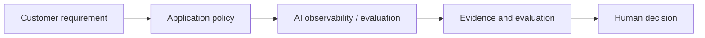

# AI observability and evaluation

[Learning path](../../docs/00-learning-path.md) · Module 9 of 13

## Learning objectives

Measure quality, latency and resource use; define release gates.

## Prerequisites and estimated time

Complete [module 8](../08-ai-architecture-and-deployment/README.md). Allow 60–90 minutes for concepts and 90–150 minutes for the lab and consulting artifact.

## Customer scenario

A sponsor asks whether a POC is ready to expand.

## Concepts

Use held-out labeled cases, retrieval recall, groundedness review, abstention and task success. Measure latency distributions, error rates and token counts; tokens are not dollars without a rate card. Log metadata by default. Evaluate segments and track model, prompt and corpus versions.

## Hands-on lab

Complete [lab-10-ai-observability-dashboard](../../labs/lab-10-ai-observability-dashboard/README.md). Record the command, configuration, observed result and one limitation. 

## Architecture diagram

Identify the untrusted input and the authority that approves an action. Expand the relevant [reference architecture](../../architectures/secure-ai-reference-architecture.md) with customer-specific boundaries.

## Troubleshooting

If the lab cannot reach Ollama, check its URL and service before changing prompts. If output is inconsistent, preserve the input and model tag, rerun the same case, and compare against the rubric. Offline fixtures validate plumbing only. See [troubleshooting](../../docs/07-troubleshooting-guide.md).

## Security considerations

Treat all model output and retrieved text as untrusted. Use synthetic data, minimize retained content and enforce permissions outside the model. For this scenario, document one disclosure risk, one integrity risk and one operational failure with an owner.

## Customer conversation prompts

What baseline must improve? Which failure blocks rollout?

## Knowledge check

1. Why keep a holdout set?
2. Name one failure mode in this scenario and a measurable test for it.
3. Explain the design trade-off to a non-specialist in two sentences.

Answer guidance

To detect overfitting to development examples. A strong scenario answer names an observable failure, the control enforcing the boundary and a pass/fail test; trade-offs should connect quality, cost or latency to the customer's requirement.

## Deliverable and next step

- [ ] Complete the lab acceptance criteria.
- [ ] Write a five-sentence customer recommendation with evidence and residual risk.
- [ ] Explain the knowledge-check answers without reading the lesson.

Continue to [AI security fundamentals](../10-ai-security-fundamentals/README.md).
