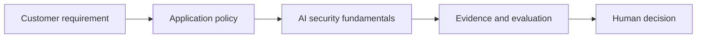

# AI security fundamentals

[Learning path](../../docs/00-learning-path.md) · Module 10 of 13

## Learning objectives

Threat-model data and tools; implement pre-retrieval access checks.

## Prerequisites and estimated time

Complete [module 9](../09-ai-observability-and-evaluation/README.md). Allow 60–90 minutes for concepts and 90–150 minutes for the lab and consulting artifact.

## Customer scenario

A security architect reviews a knowledge assistant.

## Concepts

Prompt injection crosses trust boundaries through instructions embedded in untrusted content. Separate identity and policy from model text. Address sensitive disclosure, excessive agency, output handling, supply chain and unbounded consumption with layered controls. A keyword filter is not an injection defense.

## Hands-on lab

Complete [lab-08-secure-rag-with-guardrails](../../labs/lab-08-secure-rag-with-guardrails/README.md). Record the command, configuration, observed result and one limitation. 

## Architecture diagram

Identify the untrusted input and the authority that approves an action. Expand the relevant [reference architecture](../../architectures/secure-ai-reference-architecture.md) with customer-specific boundaries.

## Troubleshooting

If the lab cannot reach Ollama, check its URL and service before changing prompts. If output is inconsistent, preserve the input and model tag, rerun the same case, and compare against the rubric. Offline fixtures validate plumbing only. See [troubleshooting](../../docs/07-troubleshooting-guide.md).

## Security considerations

Treat all model output and retrieved text as untrusted. Use synthetic data, minimize retained content and enforce permissions outside the model. For this scenario, document one disclosure risk, one integrity risk and one operational failure with an owner.

## Customer conversation prompts

What can an attacker read or change? Which controls operate outside the model?

## Knowledge check

1. Is RAG a security boundary?
2. Name one failure mode in this scenario and a measurable test for it.
3. Explain the design trade-off to a non-specialist in two sentences.

Answer guidance

No; retrieved content may itself be malicious or unauthorized. A strong scenario answer names an observable failure, the control enforcing the boundary and a pass/fail test; trade-offs should connect quality, cost or latency to the customer's requirement.

## Deliverable and next step

- [ ] Complete the lab acceptance criteria.
- [ ] Write a five-sentence customer recommendation with evidence and residual risk.
- [ ] Explain the knowledge-check answers without reading the lesson.

Continue to [AI security red teaming](../11-ai-security-red-teaming/README.md).
