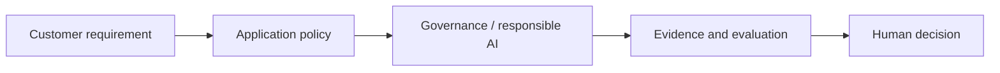

# Governance and responsible AI

[Learning path](../../docs/00-learning-path.md) · Module 12 of 13

## Learning objectives

Assign accountability; assess privacy, fairness and change management.

## Prerequisites and estimated time

Complete [module 11](../11-ai-security-red-teaming/README.md). Allow 60–90 minutes for concepts and 90–150 minutes for the lab and consulting artifact.

## Customer scenario

A steering committee needs a documented adoption decision.

## Concepts

Maintain a use-case inventory, data lineage, model cards and risk ownership. Evaluate harms across affected groups and provide appeal paths. Minimize personal data and define deletion, retention and incident response. Applicable legal obligations depend on jurisdiction and use; obtain qualified review rather than treating a checklist as certification.

## Hands-on lab

Complete [lab-11-capstone-secure-ai-advisor](../../labs/lab-11-capstone-secure-ai-advisor/README.md). Record the command, configuration, observed result and one limitation. Complete the risk register and executive briefing; assign owners and review dates to at least three risks.

## Architecture diagram

Identify the untrusted input and the authority that approves an action. Expand the relevant [reference architecture](../../architectures/secure-ai-reference-architecture.md) with customer-specific boundaries.

## Troubleshooting

If the lab cannot reach Ollama, check its URL and service before changing prompts. If output is inconsistent, preserve the input and model tag, rerun the same case, and compare against the rubric. Offline fixtures validate plumbing only. See [troubleshooting](../../docs/07-troubleshooting-guide.md).

## Security considerations

Treat all model output and retrieved text as untrusted. Use synthetic data, minimize retained content and enforce permissions outside the model. For this scenario, document one disclosure risk, one integrity risk and one operational failure with an owner.

## Customer conversation prompts

Who accepts residual risk? How can an affected person challenge an outcome?

## Knowledge check

1. Who is accountable for deployment approval?
2. Name one failure mode in this scenario and a measurable test for it.
3. Explain the design trade-off to a non-specialist in two sentences.

Answer guidance

A named organizational owner, supported by security, privacy and legal review. A strong scenario answer names an observable failure, the control enforcing the boundary and a pass/fail test; trade-offs should connect quality, cost or latency to the customer's requirement.

## Deliverable and next step

- [ ] Complete the lab acceptance criteria.
- [ ] Write a five-sentence customer recommendation with evidence and residual risk.
- [ ] Explain the knowledge-check answers without reading the lesson.

Continue to [Secure enterprise AI advisor capstone](../13-capstone-secure-enterprise-ai-advisor/README.md).
