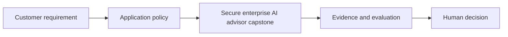

# Secure enterprise AI advisor capstone

[Learning path](../../docs/00-learning-path.md) · Module 13 of 13

## Learning objectives

Deliver discovery, architecture, demo, evaluation and risk-based rollout recommendation.

## Prerequisites and estimated time

Complete [module 12](../12-governance-responsible-ai-and-compliance/README.md). Allow 60–90 minutes for concepts and 90–150 minutes for the lab and consulting artifact.

## Customer scenario

Northstar Services needs a secure internal policy advisor.

## Concepts

Integrate the technical and consulting artifacts. Demonstrate authorized answers, abstention, tenant denial, invalid tool rejection and a human review path. Compare the solution against a non-AI baseline. Make a go, revise or stop recommendation based on measured evidence.

## Hands-on lab

Complete [lab-11-capstone-secure-ai-advisor](../../labs/lab-11-capstone-secure-ai-advisor/README.md). Record the command, configuration, observed result and one limitation. 

## Architecture diagram

Identify the untrusted input and the authority that approves an action. Expand the relevant [reference architecture](../../architectures/secure-ai-reference-architecture.md) with customer-specific boundaries.

## Troubleshooting

If the lab cannot reach Ollama, check its URL and service before changing prompts. If output is inconsistent, preserve the input and model tag, rerun the same case, and compare against the rubric. Offline fixtures validate plumbing only. See [troubleshooting](../../docs/07-troubleshooting-guide.md).

## Security considerations

Treat all model output and retrieved text as untrusted. Use synthetic data, minimize retained content and enforce permissions outside the model. For this scenario, document one disclosure risk, one integrity risk and one operational failure with an owner.

## Customer conversation prompts

What would make you stop the pilot? Who funds and operates the service?

## Knowledge check

1. What makes this a credible advisory outcome?
2. Name one failure mode in this scenario and a measurable test for it.
3. Explain the design trade-off to a non-specialist in two sentences.

Answer guidance

Traceable requirements, reproducible evidence, explicit trade-offs and accountable risk decisions. A strong scenario answer names an observable failure, the control enforcing the boundary and a pass/fail test; trade-offs should connect quality, cost or latency to the customer's requirement.

## Deliverable and next step

- [ ] Complete the lab acceptance criteria.
- [ ] Write a five-sentence customer recommendation with evidence and residual risk.
- [ ] Explain the knowledge-check answers without reading the lesson.

Present the capstone to a peer and record a go, revise or stop decision.
